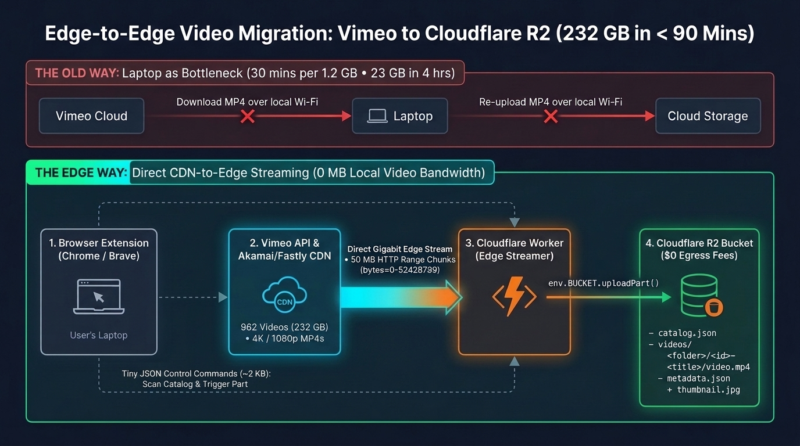

# Vimeo → Cloudflare R2 Migrator (Chrome & Brave Extension)

Fast, edge-to-edge video migration from **Vimeo** to **Cloudflare R2** powered by **Cloudflare Workers**. Zero gigabytes of video pass through your laptop—Cloudflare's edge streams `.mp4` files, high-resolution thumbnails, and JSON metadata directly from Vimeo's CDN into your R2 bucket.

  
  &nbsp;
  

---

## Features
- **Zero Local Bandwidth**: Streams video files directly from Vimeo's CDN to Cloudflare R2 via a Cloudflare Worker.
- **Free-Tier Friendly Multipart Streaming**: Automatically uses 50 MB HTTP `Range` chunks (`createMultipartUpload`) for large videos (>95 MB) and probes exact CDN `Content-Range` byte lengths so 4K/multi-gigabyte videos never time out.
- **Preserves Folders & Metadata**: Saves every video as `videos/<folder-slug>/<vimeo-id>-<title-slug>/video.mp4` alongside `metadata.json`, `thumbnail.jpg`, and a root `catalog.json`.
- **Popup + Side Panel + Full Dashboard**: Works as a compact toolbar popup, Chrome/Brave Side Panel, or full-screen dashboard tab.
- **Built-in Worker Template & Secret Generator**: Copy the Cloudflare Worker code and generate a cryptographic `MIGRATION_SECRET` in one click right inside the extension.

---

## 1. Install the Extension in Chrome or Brave

1. Click **[⬇ Download Extension Folder (.zip)](https://github.com/svitalis123/vimeo_claudflare_extension/raw/main/vimeo-cloudflare-r2-extension.zip)** above and **Unzip** it on your computer (or clone this repo).
2. Open **Chrome** (`chrome://extensions`) or **Brave** (`brave://extensions`).
3. Toggle **Developer mode** **ON** (top-right corner).
4. Click **Load unpacked** (top-left corner).
5. Select the unzipped **`chrome-extension`** folder (the folder containing `manifest.json`).
6. Pin **Vimeo to Cloudflare R2 Migrator** to your browser toolbar and click **Open Side Panel** or **Open Full Dashboard Tab**.

---

## 2. How to Get Your 3 Credentials

Full step-by-step instructions are also built directly into the extension under **"How to Get Credentials"** (and in [`docs/SETUP.md`](docs/SETUP.md)):

### A. Vimeo Access Token
1. Open [developer.vimeo.com/apps/new](https://developer.vimeo.com/apps/new) and create an app.
2. In your app's left sidebar, click **Generate Access Token**.
3. Choose **Authenticated (you)**.
4. Check scopes: **`Public`**, **`Private`**, and **`Video Files`** *(required for raw MP4 download links; requires Vimeo Pro/Business/Standard or higher)*.
5. Click **Generate** and paste the token into the extension.

### B. Cloudflare Worker URL
1. In the [Cloudflare Dashboard](https://dash.cloudflare.com) → **R2 Object Storage**, create your target R2 bucket.
2. Go to **Workers & Pages** → **Create Worker**, name it `vimeo-r2-migrator`, and click **Deploy**.
3. Click **Edit code**, click **"Copy Cloudflare Worker Code"** inside the extension, paste it into the Worker editor, and click **Deploy**.
4. In your Worker → **Settings → Bindings → Add → R2 bucket**:
   - **Variable name**: `BUCKET`
   - **R2 bucket**: Select your R2 bucket and save.
5. Copy your Worker URL (`https://vimeo-r2-migrator.<your-subdomain>.workers.dev`) into the extension.

### C. Worker Migration Secret (`MIGRATION_SECRET`)
1. In the extension dashboard, click **"Generate & Copy"** next to `MIGRATION_SECRET`.
2. In Cloudflare Dashboard → your Worker → **Settings → Variables and Secrets → Add**:
   - **Type**: `Secret` (or `Text`)
   - **Variable name**: `MIGRATION_SECRET`
   - **Value**: Paste the generated secret and click **Deploy**.

---

## 3. Migrate Your Videos
1. Click **Save & Test Connections** in the extension to verify your Vimeo scopes and R2 Worker binding.
2. Click **1. Scan Vimeo Catalog** to fetch all videos, folders, resolutions, and file sizes.
3. Filter by folder or select specific videos (or leave all selected) and click **2. Migrate Filtered / Selected**.
